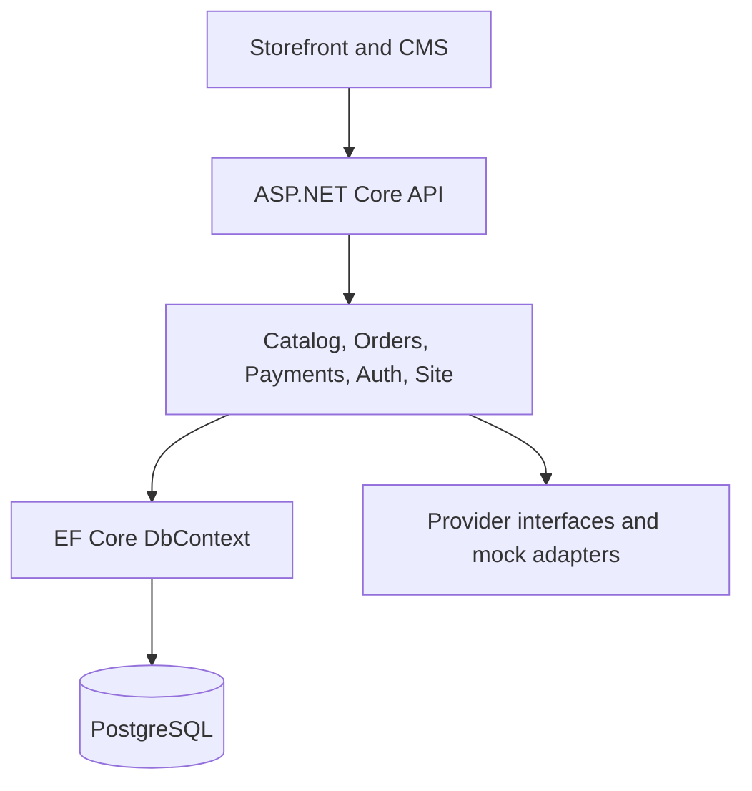
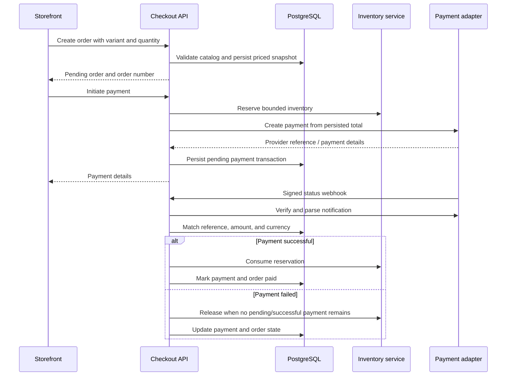

# Zetruv API — architecture and transaction flow

This document describes code present on the repository's default branch. It is
not a claim that an external payment provider is live or production certified.

## Module map

One API hosts domain-oriented feature folders in `src/Zetruv.Api/Features`.
`ZetruvDbContext` in `Persistence` provides a shared data model and EF Core
migrations. JWT protects CMS operations; public flows use separate endpoints.

## Checkout to payment

The payment implementation checks the existing order and persisted amount;
webhook processing resolves the configured provider, validates the adapter's
signature, and rejects mismatched amount/currency. `PaymentService` coordinates
state changes with `InventoryReservationService`. A background service handles
expired reservations. The `mock` adapter validates an HMAC signature for
development/staging scenarios.

## Where to verify details

| Decision | Source |
| --- | --- |
| Checkout and price validation | [`CheckoutService.cs`](../src/Zetruv.Api/Features/Orders/CheckoutService.cs) |
| Inventory reserve / consume / release | [`InventoryReservationService.cs`](../src/Zetruv.Api/Features/Orders/InventoryReservationService.cs) |
| Payment state machine and reconciliation | [`PaymentService.cs`](../src/Zetruv.Api/Features/Payments/PaymentService.cs) |
| Provider boundary and mock signature verification | [`PaymentGateway.cs`](../src/Zetruv.Api/Features/Payments/PaymentGateway.cs) |
| Schema and migrations | [`ZetruvDbContext.cs`](../src/Zetruv.Api/Persistence/ZetruvDbContext.cs) |

## Trade-offs and remaining evidence

- Feature folders reduce deployment complexity but currently share the same
  persistence context, rather than strictly isolated module databases.
- A mock gateway verifies the API contract, not live settlement behavior.
- A clean `dotnet build` establishes compilation only. Full gateway contract,
  PostgreSQL integration, concurrency, and operational recovery need distinct
  test evidence before a production-readiness statement.
